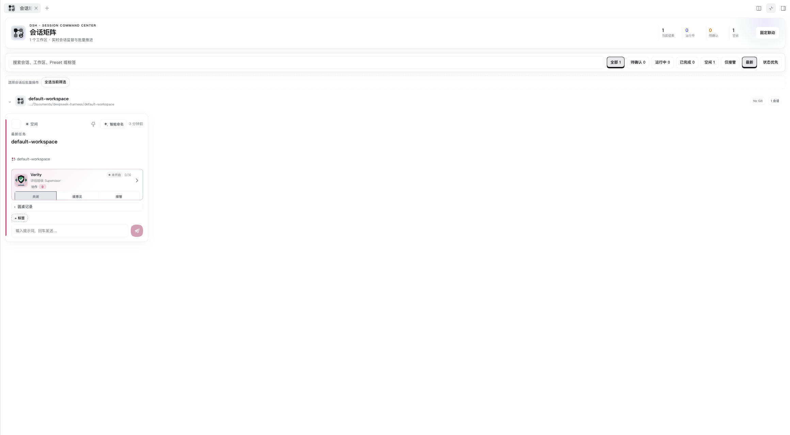

# dsh-supervisor

DSH Host + Client plugin for per-session supervision, role-aware Supervisors, durable responsibility assignments, context-health warnings and recoverable Handoff workflows.

## Platform repositories

This repository contains the DSH plugin. The independently developed Codex
edition lives at [Harzva/codex-supervisor](https://github.com/Harzva/codex-supervisor).

## Session matrix preview



The screenshot shows Supervisor 0.2.7 in DSH 0.2.2-rc.1 with the separate
Better Sidebar and session-board plugins. The matrix is optional and is not
provided by this package.

## Installation

Supervisor requires the separately installed `@harzva/dsh-role-registry`
version `0.1.0-alpha.1`. Install the registry first in the same web profile:

```sh
dsh plugin --profile web add https://github.com/Harzva/dsh-role-registry/archive/refs/tags/v0.1.0-alpha.1.tar.gz
dsh plugin --profile web add https://github.com/Harzva/dsh-supervisor/archive/refs/heads/main.tar.gz
```

Restart the DSH profile after installation. The built Host and Client modules
are included in both archives. The role registry is also available as
[source under Apache-2.0](https://github.com/Harzva/dsh-role-registry).

The optional GroupX council integration requires a compatible GroupX provider
implementing `groupxCouncil` protocol version 1; the current public GroupX
release has not been verified to provide that service. Without a compatible
provider, council features are unavailable.

## Supervisor configuration

Load `@harzva/dsh-role-registry` before this plugin. The neutral plugin owns the shared role instance and browser picker. Supervisor contributes its configured faculties once; selected expert definitions are resolved from that shared instance. A missing exact role version blocks execution.

Existing `faculties` configurations contribute domain experts. The optional legacy-compatible `mentors` array controls responsibility assignment and execution routes; it does not supply a separate fallback expert definition. Mentor-only configurations must reference a role contributed to the shared registry.

```yaml
- id: dsh-supervisor
  config:
    handoffWarnCompactions: 2
    handoffRecommendCompactions: 3
    opinionMaxTokens: 4096
    opinionTimeoutMs: 60000
    faculties:
      - id: code
        name: Code Faculty
        route: provider/model
        prompt: Review implementation evidence, correctness and delivery quality.
    mentors:
      - id: code
        name: Forge
        role: execution
        route: provider/model
        color: '#b45309'
        responsibilities:
          tags: [开发, 实现, 调试]
          workspacePatterns: ['*/engineering/*']
          presets: [standard]
          description: 负责工程实现、调试和交付闭环
```

Supported roles are `architecture`, `research`, `execution`, `verification`, and `handoff`.

These legacy responsibility categories are independent of the selected shared expert. The picker saves an exact `{ id, version }`; model overrides, output token budget and request timeout remain execution settings. Both expert calls and chair synthesis honor the configured budget (256–32768 tokens) and timeout (1–300 seconds). Empty or too-short expert responses get at most one reinforced retry. Repeated failed rounds use increasing backoff.

Each round records the exact selected role version. Its opinion attempts retain the actual prompt, provider/model, budget, timestamp and response, including a reinforced retry when used. Historical attempts remain readable after role removal or a later selection change. The public role directory omits prompt bodies.

## Basic use

Select a model in a DSH session and use `/supervise mode advice` to request
Supervisor suggestions. Review a suggestion before adopting it; `/supervise mode off` stops supervision. `/supervise status` reports the current state.
Takeover is explicitly authorized for the current run only. Automatic
continuation additionally requires an unfinished native todo from that task;
when that evidence is missing, Supervisor leaves the suggestion for manual
review. A new user task, disabling takeover or restarting the profile clears
the automatic authorization. Manual adoption remains available.

Models may still request tools or violate natural-language instructions.
Keep DSH access controls appropriate for the task; Supervisor does not
replace the host's file or tool permission policy. A new install contributes
default roles to the shared registry without enabling supervision or starting
model calls.

## Optional project memory

When a compatible Host provides project memory, Supervisor reads it as
untrusted reference material. The Host owns project binding, authorization,
revocation, and retrieval. The modern `harvisMemory` integration takes
precedence; the legacy `harvisProjectMemory` service is used only when the
modern service is unavailable.

Legacy project-memory results may inform suggestions, but they cannot be
adopted or sent by automatic takeover: the legacy interface cannot verify
authorization atomically at the point of sending. Remove that source and
regenerate a suggestion to use those actions. Raw legacy input is excluded
from stored request audits. Model-generated responses may still repeat
information from memory and can be stored in suggestion or roundtable history.

## Matrix API

- `GET /dsh-supervisor/states?ids=...` — bounded compact states including mentor, assignment, health and Handoff summary.
- `GET /dsh-supervisor/mentors` — public mentor roster without model routes.
- `GET /dsh-supervisor/roundtables?sessionId=...` — persisted execution records for the requested session.
- `POST /dsh-supervisor/assignment` — set one primary mentor and at most two collaborators.
- `POST /dsh-supervisor/state` — update supervision mode/strategy and a per-session, per-Supervisor model override through `patch.supervisorModel: { supervisorId, route }`.
- `GET|POST /dsh-supervisor/handoff` — inspect or advance a Handoff transaction.

The Handoff route uses an idempotent transaction with a preallocated target session id. It supports model-generated drafts, validated safe fallback summaries when a provider is unavailable, cold-session prompting through the official connection API, workspace/Preset inheritance, and bidirectional source/target navigation in the matrix drawer.

Supervisor HTTP routes accept loopback connections only. Browser requests must
use the same loopback origin, and state-changing browser requests must send
JSON; local command-line clients without an Origin header remain supported.
Requests through a LAN address or reverse-proxy hostname are not supported by
these routes. Do not expose them through an untrusted local reverse proxy: a
proxy that removes forwarding metadata can make remote traffic appear local.
They do not expose live Cordis objects or raw session logs.

## Data and privacy

By default Supervisor stores settings, assignments, handoffs, execution state
and bounded roundtable records in
`$DSH_HOME/storages/dsh-supervisor/supervisor-state.v1.json` (or under
`~/.dsh` when `DSH_HOME` is unset). A configured `storePath` overrides that
location. Roundtable records may contain role prompts, selected request
messages, model responses and generated suggestions; treat this file as
sensitive session data. These records are not a guarantee that model outputs
contain no private material. The optional legacy project-memory input block is
redacted from stored request messages, but model outputs may repeat it.

The documents under `docs/smart-supervision-v2/` describe a historical
architecture proposal, including stricter prospective storage rules. They are
not a claim that those rules are implemented by the current legacy store.

## State and recovery

Assignments, per-Supervisor model overrides, successful compaction counts, Handoff records and bounded audit metadata are stored atomically under the active DSH home. Removing the plugin row disables the feature without deleting sessions. Source sessions are never automatically deleted or archived.

## Checks

```bash
pnpm install --frozen-lockfile
npm run verify:p0
```

`src/` is the canonical editable source. `lib/` is derived by the single
dependency-free build script and is retained in the package because DSH loads
the JavaScript artifact directly. `npm run check` preserves the existing test
entry point; `npm run verify:p0` additionally checks the public package,
credential/private-path hygiene and pack contents.

The pinned `artifacts/dsh-supervisor-0.2.4.tgz` is the pre-P0 rollback
artifact. Its historical documentation contains a runtime session identifier,
so it is a Git-ignored local-private input and must never be uploaded. Its
digest and the explained post-tarball Client delta are recorded in the
repository-only `evidence/p0/` bundle. A clean clone does not require the
private artifact to build, test or pack, and P0 verification never overwrites
the originating machine's copy.


可靠性与 GroupX 会诊协议见 [升级说明](docs/groupx-supervisor-upgrade.md)。
